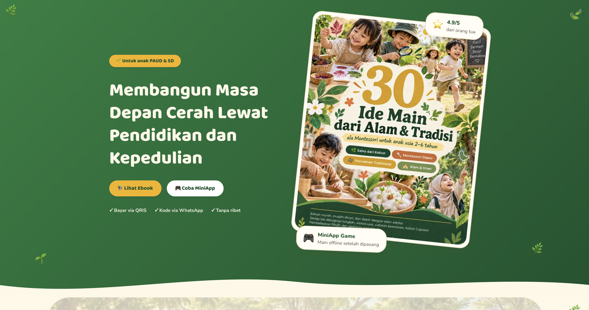

# Rumah Cahaya-bks

Marketplace ebook anak (PAUD/SD) + MiniApps HTML5 yang bisa dipasang sebagai aplikasi di HP (PWA).



🌐 **Live:** https://rumahcahaya.web.id

## Fitur

**Pengguna**
- Katalog Ebook & MiniApps, halaman detail produk
- Checkout via QRIS + upload bukti pembayaran (verifikasi manual admin)
- Kode redeem dikirim via WhatsApp
- Ebook dibaca langsung di browser / diunduh (signed URL)
- MiniApp dipasang sebagai PWA — tanpa login ulang (install token per pengguna)
- Login cukup dengan Google (tanpa daftar)
- Halaman promo: `/p/{slug}` dan sales page `/iklan/{slug}` (countdown, video, materi)

**Admin** (satu admin, `/admin/login` via email+password)
- Dashboard + laporan (Excel/PDF) + target penjualan
- Kelola Ebook, MiniApps, Produk/Bundle, Diskon
- Verifikasi pembayaran, kelola kode redeem
- Kelola Landing Page & Iklan Promo
- Backup database

## Teknologi

- Laravel 13 + PHP 8.3 + MySQL
- Tailwind CSS, Chart.js
- Laravel Socialite (login Google), PWA per MiniApp

## Instalasi lokal

```bash
composer install
cp .env.example .env
php artisan key:generate
php artisan migrate --seed
npm install && npm run build
php artisan serve
```

Akun demo (seeder): admin & pengguna — lihat `database/seeders/`.

## Deploy

Lihat `DEPLOY.md` (manual) / `DEPLOY-OTOMATIS.md` (webhook `public/deploy.php` + GitHub webhook).

## Lisensi

MIT
